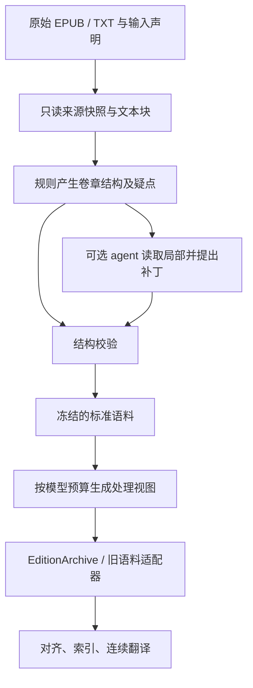

# 上游格式标准化：输入、章节结构与语料导出设计

日期：2026-10-18；实施更新：2026-10-19。状态：首批确定性导入、结构补丁及 EditionArchive 导出已实现。本文包含后续完整目标，未全部实现；当前范围和实测见[实施报告](translation-input-normalization-results.md)。

实现基线：`af04251`（跨版本索引及可恢复连续翻译）。该版本离线回归为 501 passed；限定窗口工程闭环成立，语义质量仍有未解决问题，见[复验报告](translation-cross-edition-repair-results.md)。

本设计承接[独立版本索引设计](translation-independent-edition-index-design.md)，作为对齐、知识抽取、连续翻译之前的输入层。不改变 `parallel / cross_edition / source_only` 的语义边界，也不把格式统一解释为内容对应。

## 1. 决策与最小范围

采用项目内的确定性导入管线，提供 Python API 和 CLI；agent 在需要时通过相同 API 提出结构补丁。后续技能仅封装操作流程，不承担唯一的解析实现。

第一版支持 EPUB 与 TXT；EPUB 内部 XHTML/HTML 使用通用文本块提取器。独立 HTML 文件/目录可复用读取器，但不是首轮验收必要项。PDF/OCR、DOCX、MOBI/AZW 等留给后续适配器，不把转换器输出直接认定为可靠语料。

必须支持：

- 标题位于正文或导航中，HTML `<title>` 无效、重复或缺失。
- 一个物理文件包含多章、一章跨多个内部文件，以及全本 TXT。
- 卷、章、支线、间章和附属资料在同一阅读序列中出现。
- 原始顺序、段落与来源可回查；原文不由 LLM 重写。
- 没有足够证据恢复原始章界时，保留有序的未分章正文；允许按预算建立处理分段，并明确其不是作品章节。
- 沿用现有版本档案与翻译入口，旧冻结实验能够原样重放。

本模块不推断缺页中的内容，不修正文库/Web 剧情差异，不通过重新编号建立双语映射。相邻重复文字先标记，不能无依据自动删除。

## 2. 当前代码的接入限制

| 位置 | 当前行为 | 新模块的处理 |
| --- | --- | --- |
| `translation/corpus/__init__.py:epub_entries` | 每个 spine item 产生一个条目，读取 `<title>`，按 UTF-8 解码 | 通用读取器输出物理资源及导航，章界独立识别；处理实际编码声明 |
| 同文件 `extract_paragraphs` | 日文只提取 `p#L数字/Lp数字/La数字`；中文依赖 `<p>` | 保留为站点 profile；通用提取器覆盖标题、嵌套容器、直接文本、列表、表格与 `<br>` |
| 同文件 `ingest` | 固定输入目录；日文可能按标题寻找缓存 | 新入口使用显式 manifest；通用输入不通过同名标题替换成其他缓存 |
| `translation/alignment/spider.py:build_spider_corpus` | 使用 `document_id:href` 标识条目 | 一个资源中的多个章节使用各自范围生成身份 |
| 同文件 `classify_entry` | 缺标题时返回 `empty_or_layout` | 正文存在时不能因缺标题排除；保留正文并标记标题未知 |
| `translation/editions/archive.py:EditionArchive` | 已读取 `entries.jsonl` 与 `paragraphs.jsonl` | 优先作为导出目标，补版本与完整性验证 |
| `translation/editions/index.py:plan_edition_index` | `document_id` 变化会切父节点；单条目过大时报错 | 新视图优先用逻辑卷边界；过大章节使用可回溯的处理单元 |
| `translation/editions/sequence.py:_source_document` | 将阅读条目适配为连续翻译输入 | 接收通用导出视图，保留逻辑章和处理单元映射 |
| `scripts/run_cross_edition_sequence.py` | 默认语料、索引和案例为蜘蛛实验路径 | 新建通用运行配置入口；历史脚本继续作为冻结实验入口 |

新增入口不向原站点读取器堆叠通用回退。已有站点 profile 可提供更强的来源知识，通用 profile 则不能假定这些规则成立。

## 3. 三层产物与身份



分开保存三个层次：

1. **原始材料层**：输入原始字节、编码决策、按资源顺序提取的文本块、导航及资源信息。只在输出目录建立副本，不改原文件。
2. **作品结构层**：逻辑卷、章节、段落、原始范围与结构决策。与使用哪个模型无关。
3. **执行视图层**：为现有消费者导出的条目/段落，以及必要的预算分段。改变模型预算只新建执行视图，不重新认定作品章界。

物理文件、逻辑卷、逻辑章、处理单元分别有 ID。多个文件可以归入一卷，一份 TXT 可以包含多卷。卷未知时使用显式的 unknown 分组，不把 TXT 文件名伪装为已知卷名。

### 3.1 稳定性约定

- 同一来源字节、显式输入顺序、profile、规则版本和补丁链得到相同结果与 ID。运行时间、输出目录和临时路径不进入内容身份。
- `source_id` 由输入 manifest 指定；字节用 `source_sha256` 绑定。目录中的文件顺序必须冻结，不依赖操作系统枚举顺序。
- `block_id` 绑定来源快照、资源定位和文本块位置。内容相同而位置不同的两段必须有不同 ID。
- `entry_id` 绑定版本与章界的来源锚点；`revision_id` 包含正文、分段、分类、标题选择及相关清洗规则。拆分、合并、边界改变必须产生新身份或修订。
- MVP 只保证同一冻结输入的稳定重放，不承诺编辑原文件后所有 ID 仍不变。跨修订迁移须验证对应关系，不按标题直接继承旧索引。
- 补丁绑定 `base_structure_revision`；并发或旧补丁应用在新结构上时返回冲突。

### 3.2 输出目录

```text
artifacts/translation/imports/<import_id>/
  input-manifest.json
  sources.jsonl                 # source_id、原文件哈希、保存位置、编码
  blobs/<sha256>                # 原始字节副本
  blocks.jsonl                  # 冻结文本块与资源定位
  candidates.jsonl              # 章界、卷界、段落策略的候选及证据
  structures/<revision>.json    # 不可变的结构快照
  patches/<patch_id>.json
  canonical/<revision>/
    manifest.json
    volumes.jsonl
    entries.jsonl
    paragraphs.jsonl
    provenance.jsonl
    issues.jsonl
    report.md
    comparison.html
  exports/<export_id>/
    manifest.json
    entries.jsonl
    paragraphs.jsonl
    unit-map.jsonl
    provenance.jsonl
  calls/                       # 仅启用 LLM 辅助时产生
```

`artifacts/` 继续被 Git 忽略。版本化对象通过既有 `translation.storage` 原子写入；完成标记最后落盘，未完成目录不能被下游当成完整语料。

## 4. 最小数据契约

下面的名字为新契约，不直接替换旧冻结 JSON 的 schema。

| 对象 | 核心字段 |
| --- | --- |
| `InputSpec` | `schema`, `edition_id`, `language`, `edition_label`, `version_relation`, `sources[]`, `profile`, `encoding_policy`, `paragraph_policy`, `cleanup_profile` |
| `SourceSpec` | `source_id`, `path`, `format`, `input_order`, `volume_hint?`, `encoding_override?` |
| `SourceBlock` | `block_id`, `source_id`, `source_sha256`, `resource_id`, `source_order`, `node_kind`, `raw_text`, `locator`, `ruby[]`, `asset_refs[]`, `layout_hints` |
| `StructureCandidate` | `candidate_id`, `kind`, `start_anchor`, `end_anchor?`, `title_candidates[]`, `evidence[]`, `conflicts[]`, `decision_state` |
| `Volume` | `volume_id`, `raw_title`, `title_source`, `reading_order`, `source_ranges[]`, `status` |
| `Entry` | `entry_id`, `revision_id`, `edition_id`, `volume_id?`, `edition_order`, `raw_title`, `display_title`, `title_source`, `kind`, `boundary_kind`, `source_ranges[]`, `metadata` |
| `Paragraph` | `paragraph_id`, `entry_id`, `revision_id`, `ordinal`, `kind`, `text`, `source_ranges[]`, `ruby[]`, `asset_refs[]`, `transform_ids[]` |
| `ImportIssue` | `issue_id`, `code`, `severity`, `scope`, `evidence_refs[]`, `message`, `resolution`, `affected_capabilities[]` |

`kind` 表示 narrative、前言、后记、目录、译注、参考资料等内容角色；`boundary_kind` 表示真实章界、未分章范围等结构状态，二者分开。

无标题且具有正文的条目可以是 `kind=narrative`、`boundary_kind=unresolved`。其 `raw_title` 为空，`display_title` 可为“未命名阅读条目 12”，并明确 `title_source=generated_label`。不把生成标签写成原始标题。

最小输入声明示例（路径为示意；同一版本可以列出多个有序 source）：

```json
{
  "schema": "novel-import-input-v1",
  "edition_id": "source-ja",
  "language": "ja",
  "edition_label": "待翻译日文版本",
  "sources": [
    {"source_id": "source-book", "path": "inbox/book.epub", "format": "auto", "input_order": 0}
  ],
  "profile": "generic-v1",
  "encoding_policy": "strict-auto",
  "paragraph_policy": "auto",
  "cleanup_profile": "zero-width-v1"
}
```

中文参考版使用另一 `edition_id` 独立导入。可选 `version_relation` 仅转存任务 manifest 已声明的版本关系及其对象，不由文件后缀、语言或章数推导。`path` 相对于 manifest 所在目录解析，运行路径不作为正文身份。

### 4.1 范围与清洗映射

`source_ranges` 是有序列表，支持一个段落来自多个文本块、一个章节跨多个文件。块内字符区间使用 Unicode 码点下标和左闭右开 `[start, end)`，不混用 UTF-16 单元、字节位置与可见字形数量。

- TXT 定位使用解码快照中的字符范围及原始行号，绑定原字节哈希与 codec。字节范围只有经过实际映射才填写，不把字符偏移当成字节偏移。
- HTML 定位使用资源路径、冻结 DOM 的文本节点/块位置及块内范围；原文件字节同时保存。不要求 HTML 解析器返回它不具备的字节偏移。
- `raw_text` 是提取层的原始文本，不等于完整 HTML 字节。实体解码、标签布局、ruby 读音分离等步骤单独记录。
- 每个输出正文字符应能追溯到输入文本，或被标记为程序生成的布局分隔符。删除的零宽字符、空白等也有操作记录。
- 标题匹配键可以使用规范化空白/全半角处理；保存和翻译的正文不直接使用该匹配键。

第一版沿用项目零宽清洗策略作为可配置 profile，保留原始字节与变化计数；保留注音、组合浊点和字形变体等有意义信息。来源特有的阅读顺序还原必须发生在会破坏还原证据的清洗之前。

## 5. EPUB 提取与结构识别

### 5.1 物理资源读取

1. 读取 container、package、manifest、spine，保存主阅读序列、非线性资源及缺失资源诊断。
2. 读取 EPUB 3 nav，兼容 EPUB 2 NCX；保留层级和文件内 fragment，不只取文件名。
3. 按真实资源编码解码，不统一强制 UTF-8。解析失败保留文件及错误；不使用替换字符静默吞掉字节。
4. 链接按 package/nav 所在位置解析；fragment 通过实际节点解析。失效锚点、重复目标、目录与正文顺序冲突分别报告。
5. 阅读顺序以可验证的 spine 及必要的结构决策为依据。无可靠顺序时输出待解决项，不按章节数字擅自排序。

EPUB 规范的 spine 表示内容文档的阅读序列；导航可指向文档内的位置，因此本模块不使用“一资源一章”作为通用假设。规范依据见文末。

### 5.2 通用文本块

通用提取器对可读内容做一次有序遍历，将正文、标题、列表项、表格单元、注释、插图与布局信号保存为块。不能对父 `div` 和子 `p` 分别调用 `get_text()` 后重复收录。

- 有 `<p>` 时保留其段落证据；无 `<p>` 的直接文本、`<br>` 分隔文本和嵌套容器也必须有去向。
- `<br>` 默认是段内换行证据，不无条件拆成新段；连续空行/不同块边界由段落策略判断。
- 保留 ruby 的底文与原生读音，译文用正文不重复串接读音。只有来源 profile 有证据时才区分自动生成注音。
- 技能清单与状态表保留行、列和标签的顺序。纯文本投影使用可回查的分隔符；无法可靠线性化的表格标记待处理。
- 插图及其说明保留资源引用。正文依赖图片内文字而当前没有文本时，标记相关范围不完整；不能生成空正文后报告提取成功。
- `script/style`、导航、隐藏内容等要记录分类依据，不能用“没有被正文选择器选中”代替内容审计。

### 5.3 章界决策

候选来自导航锚点、标题标签、独立标题样式、短行模式和相邻章结构。标题模式支持阿拉伯/汉字数字、日文章/話、S 等支线标签、序章/终章/间章；配置可增加作品规则。

首版采用可解释的决策等级，不把未校准的分数称为概率：

| 情况 | 默认动作 |
| --- | --- |
| 可解析的章级导航锚点与正文标题一致，范围有正文且不冲突 | 自动接受章界 |
| 一组正文标题具有稳定层级/样式，和卷层级、目录区区分明确 | 自动接受，并记录规则证据 |
| 只有编号或“短行看起来像标题” | 候选；结合邻段与全局模式复核 |
| 导航和正文标题冲突、标题可能属于技能表 | 保留冲突，交结构补丁处理 |
| 没有可靠章界但文本和顺序完整 | 保留连续的未分章正文范围 |

导航父节点的卷标题不能和其子章各自占有同一批正文。重复目录目标只表示同一范围有多个入口；不复制正文。正文开头的目录必须有目录结构、链接或集中列标题等证据才分类，不能仅因重复出现标题就删除。

章界可位于一个资源内部；跨资源合章需要有效范围、连续阅读顺序及目录/分页等证据。相同标题、相似内容或编号相邻单独都不足以自动合章。

## 6. TXT 解码、段落与卷章恢复

### 6.1 编码

优先使用显式编码及 BOM；无声明时严格尝试合理候选，结合文字分布、控制字符、异常字符等生成诊断。可选编码检测库仅提供候选，不把它的置信值当真值。常见候选按语言配置，例如 UTF-8、UTF-16、CP932、GB18030、Big5。

一个文件可能在多个 codec 下均可解码，因此“没有抛异常”不等于编码正确。无法区分且会改变正文时保留待解决项；agent 可以查看局部解码样本并选择候选 codec，不能自行改写乱码。

### 6.2 段落策略

`paragraph_policy=auto|blank_line|line|wrapped`，实际选择及参数冻结到结构快照。

- `blank_line`：空行划分段落，保留段内原始换行。
- `line`：每个非空物理行形成段落，适合本来按段保存的文本。
- `wrapped`：按有证据的固定宽度折行规则合并，记录输入行范围；对白起始、清单、标题和场景分隔不按普通正文合并。
- `auto`：对全文件统计并抽查开头、中段、末段；允许不同有证据的区域使用不同策略。存在歧义时默认保留换行并发出警告，不以句末标点规则猜完全文。

若自动换行与真实段落已无法从 TXT 中区分，报告“段落恢复不确定”，不能声称恢复了原版段落。翻译输出的源段绑定针对这份冻结导入结果，不代表出版物原始分段已被证明。

### 6.3 标题、目录与多卷

标题必须关联到实际独立行/块范围。编号连续性只作证据：允许同卷支线、跨卷重新编号、无编号标题和缺章，不重新排序或填补缺失正文。

卷标题与章标题使用不同角色。全本 TXT 中发现明确卷标题后记录多个 `volume_id`；未识别卷边界时按未知卷处理。集中列出的目录与后面的正文标题分别保留来源，目录不会成为一批空章节。

无任何可靠章界的 TXT 仍能形成有序未分章条目；超长时由执行视图按段落范围划分，不在作品结构层伪造“第 1 章、第 2 章”。

## 7. 结构补丁与 agent 职责

规则先完成低成本分析。agent 只查看候选目录、统计、冲突、标题前后少量正文及按需读取的范围；普通文件无需调用模型，也不对全本做剧情摘要。

允许的补丁操作限定为：

| 操作 | 含义与约束 |
| --- | --- |
| `set_boundary` / `remove_boundary` | 在已有文本锚点划分或合并相邻范围；不移动正文 |
| `select_title` | 从原始文本范围或实际导航标签选择标题；不能凭记忆补题 |
| `set_volume` | 将连续条目范围归入逻辑卷，卷未知允许保留 |
| `classify_range` | 将范围标为正文、目录、译注等；数据保留，改变下游用途 |
| `set_paragraph_policy` | 给出实际范围与策略，由程序重建段落 |
| `select_resource_order` | 显式选择资源顺序，须枚举原资源的完整排列及来源证据 |

编码选择属于提取配置变更，会生成新的文本块快照；旧结构补丁不能在新解码文本上自动继续。已知站点的段落还原使用专门 profile；通用结构补丁不提供任意正文重排。

补丁示例（ID 和偏移均为示意）：

```json
{
  "schema": "import-structure-patch-v1",
  "base_structure_revision": "structure:abc",
  "operations": [
    {
      "op": "set_boundary",
      "at": {"block_id": "B0142", "char_offset": 0},
      "kind": "chapter",
      "title_ref": {"block_id": "B0142", "start": 0, "end": 8},
      "evidence_refs": ["candidate:C17"],
      "reason": "与相邻章节使用相同标题结构"
    }
  ]
}
```

补丁不接受 `replacement_text`。程序验证锚点、范围、来源修订、原顺序和覆盖后才生成新结构版本。补丁申请不等于人工审查通过；保存 `decision_by=rule|agent|human` 与证据。

`select_resource_order` 是唯一允许显式改变资源阅读顺序的操作：保存原 `source_order`，另外记录选定顺序及理由；文本块内部顺序不变。没有该操作或专用来源还原 profile 时，结构拆分/合并不能改变读取到的先后顺序。

模型辅助默认关闭。启用时建议单个疑点最多 2 次请求，整次导入默认最多 8 次，并接受用户更小的预算；跨重启不重置已消费请求。格式错误可有界重试，语义分歧保持未决。请求、响应、解析与补丁分别保存，重放不重新付费。复用现有 provider 与请求账本机制，不创建另一套密钥配置。

后续技能可以规定“inspect → plan → read → patch → validate → export”的操作顺序。技能安装不是导入功能的运行前提，也不要求每本书修改源代码。

## 8. 验证、状态与阻断边界

### 8.1 机械不变量

1. 来源哈希、codec、资源位置与引用锚点有效；阅读顺序有冻结依据。
2. 每个属于导入范围的可读文本范围都有角色和去向：正文、标题、附属内容、待解决项等。角色不能重叠占有正文；引用相同范围不等于复制一份正文。
3. 每段正文只属于一个逻辑条目；执行视图中每个目标正文范围也只拥有一次。只读上下文重叠必须单独标记。
4. 拼回正文时，与“原始文本经过已声明转换”的结果相同；每项删除、合并、生成分隔符有依据。
5. 标题/注音/插图等附属范围有独立去向，不能把它们从纯文本删掉后当成不存在。
6. 导出满足 `EditionArchive` 的 edition/revision/ordinal/ID 约束，来源映射可回读。
7. 相同输入重放产生相同身份和数据；更换结构修订后旧依赖被拒绝。

覆盖审计不能只检查已经抽取的 `<p>`。需从每个读取资源的文本节点清单/解码行清单检查未归属内容，才能发现选择器漏提。它证明的是本次输入的结构覆盖，不证明原下载文件没有缺页或 OCR 错误。

### 8.2 准入状态

| 状态 | 典型情况 | 下游行为 |
| --- | --- | --- |
| `ready` | 结构和正文覆盖检查通过，无未决影响项 | 可以导出和运行 |
| `ready_with_warnings` | 无标题、章界不确定但正文/顺序完整、疑似编号缺口等 | 导出时保留限制；允许翻译和按范围建索引 |
| `needs_resolution` | 编码歧义改变正文、顺序冲突、正文遗漏/重叠、正文图片未识别 | 不把受影响范围标为可用；无关范围可显式导出 |
| `unsupported` | 读取器不存在或格式无法解析 | 保留诊断，不生成伪成功语料 |

范围导出必须指定范围并写出覆盖清单，不能静默跳过坏章节后报告“全本成功”。跳过原文缺口继续翻译时，该缺口也须进入下游历史覆盖信息。

`ready` 仅是结构准入，不赋予语义金标准资格；新导入默认 `semantic_status=unreviewed`、`evaluation_eligible=false`。可靠配对和人工核查按现有流程另行确定。

## 9. 导出到现有翻译系统

### 9.1 独立版本档案

优先导出 `EditionArchive` 已使用的字段：条目包含 `entry_id/edition_id/revision_id/document_id/edition_order/native_order/raw_title/language/kind`；段落包含 `paragraph_id/entry_id/edition_id/revision_id/ordinal/kind/raw_text`。

`raw_text` 在兼容输出中按现有约定放入供翻译使用的正文；真正的原始字节、提取文本和转换链通过 provenance 回查。不得声称这个兼容字段就是原始文件字节。

新字段放在版本化 manifest 与 metadata 中：`volume_id`、`logical_entry_id`、`source_ranges`、`boundary_kind`、`title_source`、`import_revision`、`quality_issues`。输出通过适配器生成，不直接修改既有实验目录。

新导出的 `document_id` 使用版本内稳定的兼容分组（默认 `<edition_id>:import`），不承担原文件定位；实际一个或多个文件由 `source_ranges` 表达。索引不得再借该字段猜测新输入的卷边界。`edition_order` 是当前视图的阅读顺序，原逻辑章顺序另存 `logical_entry_order`。

索引增加新的边界 profile：有 `volume_id` 时采用逻辑卷，未知卷时采用版本内未知分组；旧输入缺少新 profile 时继续使用 `document_id`，保持旧计划身份。卷编号不用于双语对齐。

manifest 保存 `view_fingerprint`；新索引、实体用例和连续运行必须依赖同一视图，不能混用 canonical ID 与处理单元 ID。兼容加载器对新 schema 校验完整性状态和导出清单，旧无该 schema 的输入保持原行为。

### 9.2 过长章节与执行视图

正常章节直接导出为一个条目。只有单章/未分章范围超过实际消费者预算时，按连续段落范围建立处理单元：

- 原逻辑章 ID、原题、分段序号及完整单元列表保存在 `unit-map.jsonl`。
- 单元有自己的 `entry_id/revision_id`，正文段保留 `canonical_paragraph_id` 与来源。跨段上下文仅供只读引用，不重复生成译文。
- `boundary_kind=budget_segment` 和生成的显示标签不能冒充作品章名；重新装配按原顺序连接各单元结果。
- 单章所有目标单元完成后，报告才标记该逻辑章完成；中间单元失败保留已经生成的结果。
- 邻近章节数量和索引的章数限制按逻辑章计数，token 限制按实际单元累计；不能把拆出的 10 段误当 10 章。
- 历史可见性按已完成的源文范围判断；同章后续单元也属于未来。不能因为开始翻译这一章就注入包含全章未来内容的摘要或译文，近章上下文只包含可见前缀。
- 单个原段落本身超限时，MVP 返回 `oversized_paragraph` 待处理，不通过任意截断宣称已经支持。

视图预算复用 `ModelCapacity`、`RoleBudget`、token 估算膨胀系数与 safety reserve，同时考虑翻译输出容量及索引输入容量。输出需求的估算使用显式配置并保留不确定性，不能把输入能放下等同于译文能输出完。运行中仍超限时另建视图/分支，不在已有提交上静默重分段。

### 9.3 旧平行语料路径与通用运行配置

旧 `chapters.jsonl/paragraphs.jsonl` 路径通过单独适配器接入，保留源版本和范围。不为缺少编号的章臆造 `match_key=main:N` 作为双语配对依据；下游仍可按正文建立候选。

连续运行内部若继续使用 `main:N` 作为工作条目定位，其 N 只能表示该冻结运行的阅读顺序，不代表作品原标题编号，也不得用于跨语言配对。原章号、阅读顺序与引用 ID 在报告中分别展示。

通用运行配置显式指定源/参考语料目录、版本 ID、目标条目范围、索引目录、模式和预算。历史蜘蛛 runner 保留原默认与冻结身份；新入口不依赖文件名含特定作品名。跨版本 prompt 中的目标/参考版本名称也应来自配置，新 profile 才改用通用称呼，旧 Web/文库提示保持可回放。

## 10. API 与 CLI

下面列出目标接口全集。当前实现的签名、CLI 和限制以文末实施状态及[实施报告](translation-input-normalization-results.md)为准；例如尚未实现预算分段参数和模型辅助。

| API | 输入 → 输出 | 模型调用与副作用 |
| --- | --- | --- |
| `inspect_input(spec)` | 输入声明 → 格式、编码/目录候选、规模与问题 | 无模型；只读源文件 |
| `extract_sources(spec, output)` | 输入声明 → 来源快照、块及提取报告 | 无模型；创建不可变提取产物 |
| `propose_structure(import_id, rules)` | 提取结果 → 候选、结构草案、疑点 | 默认无模型；保存规则身份 |
| `read_source_range(import_id, refs, context)` | 实际范围 → 原文、结构与 provenance | 无模型；有界读取，不触发构建 |
| `apply_structure_patch(import_id, patch)` | 基础修订及操作 → 新修订或冲突 | 无模型；不改原结构版本 |
| `validate_import(import_id, revision)` | 冻结结构 → 分范围报告与准入能力 | 无模型；可以重复执行 |
| `export_corpus(import_id, revision, target, scope, budget)` | 通过校验的范围 → 标准语料/执行视图 | 无模型；目标为 `editions-v1` 或 `parallel-v1` |
| `assist_structure(import_id, issue_ids, budget)` | 指定疑点 → 带证据的候选补丁 | 显式付费步骤，不自动当作已验证结构 |

CLI 在现有 `novel-translate` 下新增 `import` 子命令，保留原 `ingest`：

```text
novel-translate import inspect --manifest inputs.json
novel-translate import plan --manifest inputs.json --out artifacts/translation/imports/example
novel-translate import read --run <run> --ref <block-or-range> --context 3
novel-translate import apply --run <run> --patch structure-patch.json
novel-translate import validate --run <run> --revision <revision>
novel-translate import export --run <run> --target editions-v1 --out <corpus>
novel-translate import run --manifest inputs.json --out <run> --assist none
```

`plan` 包含提取和规则提案；`run` 串联确定性步骤，只在准入条件满足时导出。输出包含 `status`、修订 ID、产物位置、问题列表及可继续的步骤。读取/验证不调用模型；付费辅助通过显式选项和请求预算启用。

## 11. 模块划分与实施顺序

拟新增 `translation/ingestion/`：`schemas.py`、`sources.py`、`epub.py`、`txt.py`、`blocks.py`、`structure.py`、`patches.py`、`validation.py`、`export.py`、`assistance.py`、`service.py`。不先建立插件注册框架或通用图数据库；首版使用明确的两个读取器和少量 profile。

| 阶段 | 工作与主要文件 | 完成条件 |
| --- | --- | --- |
| F0：契约与回归基线 | schemas、来源快照、确定性身份；构造自有文本 fixtures；登记旧语料测试范围 | 能表示一章跨文件、单文件多章和未知卷；旧输入接口不变 |
| F1：通用提取 | EPUB/TXT 读取器、通用文本块、编码诊断、来源映射、清洗记录 | 不依赖站点段落 ID；覆盖 p/div/br、ruby、表格与不同编码；提取遗漏被报告 |
| F2：结构识别与校验 | 卷/章候选、TXT 段落策略、目录识别、补丁、报告 | 标准案例自动恢复；歧义可通过补丁解决；所有正文归属与原顺序可验证 |
| F3：下游导出与执行 | editions/parallel 适配器、逻辑卷边界、预算单元、通用运行配置 | 两种管线的离线集成通过；拆分单元可重组；旧运行可重放 |
| F4：agent 辅助与实测 | 有界局部查证、补丁提案、持久请求预算；多格式与真实数据试验 | 无效/过期补丁被拒绝；辅助失败不丢数据；完成指定窗口端到端并导出 IO |

F0–F3 先形成无 LLM 的最小标准化管线。F4 验证 agent 辅助的价值后再考虑独立技能；不把创建技能作为 F0–F3 的前置条件。

F3 涉及的既有文件主要为 `translation/cli.py`、`translation/editions/archive.py`、`translation/editions/index.py`、`translation/editions/sequence.py` 及连续运行输入构建处。任何 prompt、索引边界、引用身份变化都采用新 profile，并添加旧输入回放验证。

当前 `translation.storage.code_fingerprint()` 会统计整个 translation 目录。新增模块后源码指纹自然变化，不能据此重新构造旧运行请求；恢复路径须继续读取旧冻结请求/身份。回归需明确验证这一点，不能只验证新 profile 的默认值。

## 12. 验证矩阵与最低验收

### 12.1 可确定真值的结构变体

使用自编短篇 fixtures，明确记录卷、主线章、支线、段落和附属内容，然后生成不同容器。小说全文及大体积实验产物留在本地，不加入测试代码仓库。

| 场景 | 要验证的结果 |
| --- | --- |
| EPUB 每章一文件且有目录 | 基础正文、顺序及标题恢复 |
| 全书一个 XHTML，目录指向不同 fragment | 多章不重复、不漏章；同文件不同条目身份唯一 |
| 多章同文件，仅有正文标题，`<title>` 是书名 | 不把全书误归为卷介绍；正确区分标题层级 |
| 一章跨 3 个 spine 资源 | 有证据时合并，来源范围完整；证据不足时保留不确定性 |
| 无 p、嵌套 div、br、列表、状态表、ruby | 无父子文本重复；技能行、读音和正文保留 |
| 无标题但有正文 | 正文进入未分章条目，不归为封面丢弃 |
| 多卷 TXT、S 支线、重复编号、开头目录 | 卷/章分开，保持原阅读顺序，目录不变成空章 |
| UTF-8 BOM、UTF-16、CP932、GB18030 样本 | 正确解码或明确阻断，不静默引入替换字符 |
| 固定宽度折行与真实逐行对白混合 | 未证实的换行保留；策略变更可回溯 |
| 正文含类似“第 3 章”的对白或技能名 | 不仅靠正则误分章；候选证据可检查 |
| 失效目录、资源缺失、图片正文 | 受影响范围不被报告为完整可用 |
| 同标题不同章节、重复句子 | 不因标题/文本相同自动去重 |
| 超长章导出多个预算单元 | 原章身份不变，目标范围各出现一次，完整性按原章汇总 |
| 过期补丁、非法锚点、区间重叠、重启 | 不改变冻结结果；重放无新增付费 |

### 12.2 现有语料的变形测试

从《転生したら剣でした》和蜘蛛样本的已核查局部范围生成不同包装：合并内部文件、去掉 `<title>`、只保留正文标题、导出 TXT、将同章拆成数个资源。冻结原始选择范围和生成规则作为结构真值。

比较正文和来源顺序时按各格式声明的可表达信息检查：普通 TXT 若没有编码 ruby/插图，不能要求恢复该格式已丢失的信息；必须记录这一限制。现有语料的结构一致性也不等于其译文已成为语义金标准。

至少加入来源不同的实际外部 EPUB/TXT 样本再报告真实格式泛化；若尚无这类输入，验收明确标为“合成变体及现有语料验证”，不声称已覆盖网上任意文件。

### 12.3 下游实验

1. 离线验证两种导出加载、来源引用、卷边界、单元完整性及旧冻结缓存重放。
2. 选一个可靠平行窗口和一个跨版本窗口，各连续翻译至少 3 个逻辑条目；至少一个案例包含合章输入或无元信息标题。
3. 对比标准包装与变体包装的正文、结构、参考模式和已选材料。模型译文不要求字节相同，格式导入的正确性主要由结构真值证明。
4. 实测包括一个跨文件章界和一次预算分段；记录全文输入输出、费用、失败恢复与单元重组。语义问题单独归因，不靠整体译文“看起来正常”验收导入。
5. 先运行相关新增测试，再运行完整回归；真实调用使用显式模型配置与请求预算，不启动全书翻译。

最低验收：可支持范围内的输入具有完整来源映射和可重复结构结果；高风险缺口被明确报告；既有两条翻译路径能够消费导出；旧实验身份和缓存不受破坏。任意格式完全自动恢复和出版级语义正确率不属于本模块的验收承诺。

## 13. 实施时的优先取舍

- 首先解决通用提取和章界恢复；先不用 LLM 判断全书剧情。
- 优先接受缺标题、章界不确定但正文完整的输入，不为了获得漂亮目录强行分章。
- 先记录疑似重复、广告和异常字符；仅对有来源证据的范围分类或清洗。
- 模型更换引起的预算变化只影响新执行视图；不覆盖原章结构和已提交译文。
- 导出 EPUB 可在后续复用标准语料实现，当前不需要经 EPUB 再解析一遍。
- 首版不增加专用 GUI；Markdown/HTML 对照报告、CLI 和结构补丁足以执行审查。

参考：W3C《EPUB 3.3》的 package/spine 与 EPUB navigation document 定义；实现时同时验证本地 EPUB 2 NCX 兼容样本。相关规范入口为 `https://www.w3.org/TR/epub-33/`。

## 14. 首批实施状态（2026-10-19）

已提供 `translation.ingestion` 的 `InputSpec / SourceSpec`、`inspect_input`、`extract_sources`、`propose_structure`、`read_source_range`、`apply_structure_patch`、`validate_import`、`export_corpus` 和 `normalize_input`。CLI 支持 `import inspect/extract/plan/read/apply/validate/export/run`，无需模型即可执行。

本轮实现 F0、F1 的文本导入核心，F2 的保守章界识别和块级结构补丁，以及 F3 的 EditionArchive 导出和逻辑卷索引边界。不能据此将 F0–F4 全部标记完成。

- 章界优先使用可定位的导航或明确标题；正文弱编号候选保留在正文，不直接移作标题。无标题仍可导出未分章范围。
- TXT 的 `auto` 首版保留物理行并报告歧义；尚不自动推断折行宽度或分区选择不同策略。`blank_line / line / wrapped` 可显式选择，补丁可按条目修改。
- 卷信息支持输入 `volume_hint` 和显式 `set_volume` 补丁；尚未自动还原所有嵌套目录或全本 TXT 卷结构。新导出使用 `logical-volume-v1`，旧数据继续使用原索引规则。
- 结构补丁支持完整块边界的设置、移除，原始块标题选择、连续条目分类、段落策略和卷归属。补丁不支持正文替换、块内字符切分、资源重排；编码选择需重新提取。
- 已校验来源快照、正文块归属、顺序、结构指纹与导出完成标记。来源、提取或结构错误会阻断导出。
- 尚未实现预算处理单元、旧 parallel-v1 导出、通用连续翻译 runner、HTML 对照报告、按范围排除坏资源、自动目录段识别和付费 agent 辅助。图片资源只保留引用并发出诊断，不执行 OCR，也不保证图片中的文字已经进入语料。

可重复运行的现有样本变形验证位于 `scripts/verify_input_normalization.py`；生成的文本、EPUB 和结果保留在被忽略的 `artifacts/` 目录。
