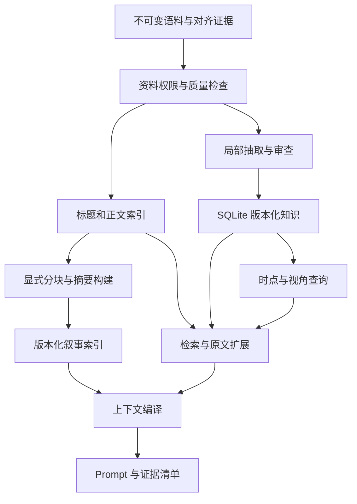

# 翻译知识库补充设计：时序、证据、检索与接口

版本：0.5  
日期：2026-10-16  
状态：P4 已实现证据、版本化知识、基础检索与工作集的有限闭环，见 [P4 结果](translation-p4-results.md)；P4.1 已完成分层索引、上下文及单章真实对照，见 [实施结果](translation-p4.1-results.md)。本文完整时序/图谱契约仍为后续设计，正式分层契约见 [P4.1 设计](translation-hierarchical-context-design.md)，总体约束见 [管线规划](translation-pipeline-plan.md)。

2026-10-16 后续补充：[双语分块摘要与翻译元信息](translation-bilingual-block-metadata-design.md)。v2 首版已允许中文对照加入分块输入，同次提取基础角色描述、人物/专名译法及用法证据，再确定性汇总候选元信息并独立注入；真实试验及可靠性问题见 [v2 记录](translation-p4.1-bilingual-results.md)。既有 v1 产物不变，完整人物消歧和时序功能仍待实施。

P6具体执行契约见 [局部事件、人物状态、知情边界与对白分析](translation-p6-design.md)。首版使用原文证据、部分时间顺序和按视角生成的工作集；既有摘要继续导航，图作为查询投影。明确列出尚未实现的API、旧assertion迁移边界，以及已审知识／模型候选两种实验臂，避免将P4预留参数视为已实现时序推理。

## 1. 设计决定与适用范围

采用“证据档案 + 分层叙事索引 + 有版本的事实与事件库 + 多路检索 + 按时点生成的局部图”。底层先使用 SQLite；原文档案保持不可变，JSON/JSONL 用于导出和审查。近期先建立叙事索引，图是后续知识查询视图，不是唯一存储形式。

当前决定更新为：用标题及阅读顺序划分候选块，读取允许范围的完整原文，构建块整体与区间详细摘要，再按近章/近块/远块确定性注入。先本地索引与 mock，再显式有预算的小规模真实构建；通过验证后才扩大覆盖，不自动启动全书任务。全书精细事件抽取、段落 embedding 和完整人物图不是本轮前置条件。正式窗口语义、质量门禁和预算行为以 [P4.1 设计](translation-hierarchical-context-design.md)为准。

设计目标：

- 核心约定和当前工作集能够在预算内完整进入 prompt；全书事实不要求全部进入 prompt。
- 允许延迟精细整理，但原文必须可检索、可定位、可回查。
- 明确区分资料访问权限、故事时点适用性和译文允许显式表达的信息。
- 先保存候选、证据和不确定性，再接受知识；不把模型输出直接当作事实。
- 普通查询不隐含付费模型调用；按需构建有明确范围、预算和缓存。
- K0 冻结后不变；后续修正保留历史，并能定位受影响的派生物。

P4 已实现有限译名/风格记录与简单名称卡，未证明稳定翻译收益。P4.1 v1 聚焦分层索引和上下文，预留核心实体卡插槽；v2 首版已把基础角色描述、块级译法和候选元信息前移到双语分块构建，抽取语义可靠性仍未解决。P6 扩展复杂事件、时序关系、人物知情与对白分析，P7 实现连续翻译的状态提交和增量压缩。

## 2. 成本与信息覆盖

| 层次 | 内容 | 构建方式 | prompt 使用方式 |
| --- | --- | --- | --- |
| 证据档案 | 原文、译文、标题、段落和版本 | 沿用规范化语料；按权限建立索引 | 按需取原文范围 |
| 叙事导航 | 标题、块整体摘要、区间详细摘要、原文入口 | 标题索引先行；显式按块/可见前缀生成并审查 | 近块整体及详情、远块全部整体摘要 |
| 结构化知识 | 实体提及、术语、事实、事件 | 语义知识局部建立；复杂状态留待后续 | 核心约定与相关项，实体卡接口可为空 |
| 翻译工作集 | 三层叙事上下文、核心约定、当前原文 | 每次任务确定性编译 | 近章完整双语；超预算显式失败 |

懒创建延迟的是语义抽取、消歧和结构化整理，不是保存原文。标题只是召回线索，不能保证覆盖所有回忆或伏笔；正文检索不受标题命中的硬限制。查询无结果不能推断故事中不存在该事实。

为每个范围和抽取任务分别登记覆盖状态，例如 `indexed`、`attempted`、`extracted`、`reviewed`、`failed`、`stale`。记录 schema、模型、来源版本和任务类型；某范围已审查术语，不代表事件与人物状态也已审查。已运行一次抽取也不代表得到完整事实集。

生成块摘要需要读取相应完整正文；覆盖 S tokens 的静态语料单遍输入为线性成本，可见前缀的反复构建另计。成本报告分开统计索引、摘要、抽取、审查、翻译及缓存重用，不将懒创建描述为无成本。

## 3. 时间、揭示位置与人物视角

### 3.1 三个独立维度

| 维度 | 含义 | 表示 |
| --- | --- | --- |
| 故事时间 | 事件发生、状态成立的时间 | 事件锚点、场景、区间、相对顺序或未知 |
| 揭示位置 | 文本在哪里提供此证据 | 来源版本、章节、段落，必要时字符偏移 |
| 知识版本 | 系统何时接受、修正、撤销知识 | 快照、父提交、修订 ID；系统时间仅供审计 |

不得用章节顺序直接替代故事时间，也不得用数据导入时间替代揭示位置。相同事实可在多处出现，每条证据保留自己的揭示位置；在可见视图内，有充分的可见证据才可使用该事实。

需要支持的时间表达：`before`、`after`、`overlaps`、`during`、已知区间、相对时间和未知。没有足够约束时返回部分顺序，不生成虚假的完整年表。`before` 不推出 `causes`；不相关分支或梦境等不能直接共用一条时间轴，初版不能表达时保留未决项。

区间边界必须区分“已知结束”“观测到某时点仍成立”“结束未知”“整个时间范围未知”。禁止将 `valid_to=null` 统一解释为永久有效。查询输出可为 `applicable`、`not_applicable`、`uncertain`；不确定不能伪装成否定。

### 3.2 示例：关系变化与回忆

假设第 10 章 A 加入公会，第 40 章 A 离开，第 70 章回忆其加入前已认识会长：

- 加入、离开、此前相识是三个事件；各自保存参与者、证据、故事时间约束及揭示位置。
- 离开结束一段关系，不撤销过去加入的事实；再次加入产生新的有效区间。
- 只允许第 20 章前资料的视图不能使用第 70 章的新证据。
- 使用最新快照回看早期事件，与模拟当时读者所知，是不同查询。
- “第 70 章读者知道”不意味着任意人物也知道。
- 新读到的描述可能是回忆、撒谎、误解或修正，不能按章节号或系统时间自动覆盖旧描述。

### 3.3 视角、身份和不确定性

世界叙述、人物声称、人物相信/怀疑、系统推断分别存储。P6 中人物信念可指向某个命题或声明；初版预留类型，不能把字符串字段冒充已实现的知情推理。

“没有记录某人知道”不推出“某人不知道”。状态推断需保存推导规则和依赖；直接陈述与推断在输出中可区分。原文可以自然保留的对白歧义，不强行补上姓名或性别。

实体 ID 不包含剧透性显示名称。身份揭晓先保存带证据和可见范围的身份对应，不能无条件全局合并别名。来自后文的身份合并、规范名称或候选排序本身也可能泄漏信息，必须在实验视图中重新判断。

## 4. 数据模型与修订语义

以下为拟议对象，不要求 P4 建立全部推理能力。

| 对象 | 关键内容 | 阶段 |
| --- | --- | --- |
| `Evidence` | 原文/译文范围、语言、文本哈希、修订、质量、来源依赖 | P4 |
| `ChapterEntry` | 标题、篇章、阅读顺序、正文入口；中文标题独立受权限控制 | P4 |
| `BlockIndex` / `SummaryArtifact` | 连续块及区间、整体/详细摘要、精确可见范围、来源依赖与覆盖 | P4.1 |
| `Entity` / `Mention` | 稳定身份、具体出现位置、候选指向和消歧依据 | P4 简版 |
| `Convention` | 源形式、中文形式、类型、合法变体、适用范围、约束强度 | P4 |
| `Assertion` | 主体、谓词、客体或值、视角、故事范围、证据、审查状态 | P4 最小记录；P6 扩展 |
| `Event` | 事件类型、参与者及角色、时间约束、状态变化、证据 | P4 契约/夹具；P6 实现 |
| `Revision` / `Dependency` | 修订、父提交、撤销、传递依赖、失效标记 | P4 基础；P7 连续提交 |
| `CoverageRecord` | 哪个范围接受过哪种处理、版本、失败和未决项 | P4 |
| `Snapshot` / `ContextBundle` | 冻结身份、允许资料、入选内容、遗漏原因、token 与依赖清单 | P4 |

`Convention` 的表达适用范围与 `Assertion` 的故事有效时间分开。例如某译者在第 500 章开始使用新译名，是译文区间约定，不代表人物在故事中改名。称谓还可依赖说话者、受话者或场景；条件不能判定时返回候选而不是全局替换。

概念性声明结构：

```text
Assertion {
  id, revision_id,
  subject, predicate, object_or_value,
  story_scope, perspective,
  evidence_ids, derivation,
  status, supersedes
}
```

约束：

- 一条接受项必须有有效证据及审查记录；置信分数不能代替审查状态。
- 同一事实的多个出处可以聚合为证据集合；视角、时间或含义不同的项不能仅凭端点相同而合并。
- 关系终止、知识纠错、观点冲突分别表示。`supersedes` 表示修订，不表示故事中发生了状态变化。
- 谓词的互斥性、对称性、持续性不能通用猜测；没有明确规则就保留多项。
- 多方事件保存为事件及参与角色，不展开成缺少条件的一组两两关系。
- 矛盾不靠多数表决消除；保留冲突组、证据和待决原因。
- 历史记录不可静默改写，快照可复现；来源修订后标记依赖项失效，不用旧证据冒充新证据。
- 事实优先依据原文；中文表达约定依据可靠双语范围。现有译文不作为世界事实的独立权威。

## 5. 导航、检索和局部图

### 5.1 无生成模型的启动流程

1. 读取规范化章节、标题、目录和正文，验证来源修订及质量标记。
2. 以保留段落 ID 的段落组建索引，记录边界和邻接关系；不静默截断长段。
3. 建立标题、正文文本索引和已审查别名索引。标题里的时间词仅标为线索。
4. 按政策过滤候选与派生资料后，合并标题、正文、实体、已有证据的召回结果。
5. 展开邻近段落并回查原文；需要时执行有预算的按需抽取。

向量检索是可选通道，有独立模型配置和预算。已有 paragraph embedding 仅在文本粒度、预处理和模型身份兼容时复用，不能直接把段落对齐向量当成已完成的全书检索索引。

日文、中文短名字需专门测试。可采用字符 n-gram 与精确别名匹配，初版不依赖空格分词；短字符串或标点查询应有确定性回退。标题没命中不影响正文候选进入结果。

### 5.2 防止权限和历史信息泄漏

查询视图显式绑定资料政策、快照和目标位置。原文目标章可以是待翻译输入，而其参考译文被隐藏；不能用同一个布尔值同时禁止这两者。现有 `hidden_source_ids` 语义通过兼容层迁移，不能直接解释成“目标原文也不可读”。

允许访问、故事时点适用、允许显式表达是三层判断。补缺协议可能允许后文译名样本，但不能据此在前文补写身份解释。顺序续译默认不读取未来原文，保持现有 `allow_future_source` 的未实现边界。

在抽取、摘要、实体合并和索引构建之前建立可见范围；不能只对最终 prompt 做字符串过滤。排序统计、规范名称和摘要若依赖禁用资料，也属于泄漏。优先按可见语料生成隔离索引；如共享底层存储，检索统计和 top-k 必须仅依赖允许范围，不能先在全书取 top-k 再过滤。

独立文本的纯编码向量缓存可按合法来源和完全一致的配置复用，但每次读取仍校验权限；禁止复用夹杂隐藏资料的聚合向量、摘要或知识合并结果。派生物的来源依赖必须传递。

### 5.3 局部图与按需构建

历史图保留变化；当前场景图只显示适用项。查询限定种子实体、谓词、跳数、时间和视角；无法判定时保留不确定标记。P4 不要求实现通用图遍历或自动时间线推理。

按需构建由明确的信息需求、覆盖缺口或复核任务触发。模型可能无法发现隐含知识缺口，因此仍固定提供邻近上下文、已知约定和必要原文；不能以模型自报“信息充分”保证质量。

摘要是可重建的导航产物，有来源和版本，不直接升级为事实。P4.1 用显式计划预建工作集需要的块/前缀摘要；查询和编译不得付费补建。缺覆盖或超预算应明确失败，不能悄悄省略远块。

## 6. 存储与内部模块



SQLite 是结构化记录和提交状态的唯一可变主存储；JSON/JSONL 为快照导出，不进行双向隐式同步。原始语料仍由不可变文件持有。全文索引、向量索引、摘要和局部图均可重建；索引必须标注所对应的快照和政策。

拟议模块：

```text
translation/knowledge/
  schemas.py       # 知识、证据、适用范围、覆盖状态
  store.py         # SQLite schema、事务、修订、冻结与导出
  visibility.py    # 资料权限、用途限制、来源闭包
  evidence.py      # 版本绑定、范围读取与质量门禁
  retrieval.py     # 标题/正文/别名召回和邻接扩展
  extraction.py    # 有界抽取、校验、覆盖记录、缓存
  review.py        # 接受、拒绝、冲突与依赖失效
  service.py       # 对外接口
translation/context/
  compiler.py      # 工作集、优先级、预算、依赖和指纹
```

目录在实际使用时创建，不预建空壳。P6 再按实现需要增加 temporal、state 等模块；不引入图数据库服务或通用事件流基础设施。

P4.1 拟新增 `translation/narrative/` 承载分块与摘要，复用证据、修订和模型适配设施；接入现有 context 编译模块。摘要不冒充 Convention，独立数据契约及 API 见 [分层索引设计第 5 节](translation-hierarchical-context-design.md)。

## 7. 对外 API 契约

先提供 Python API 和 CLI，不建立 HTTP 服务。以下为目标契约；阶段列表示首次计划实现，不代表已有能力。读操作不得隐含修改知识或调用付费模型。

```python
view = kb.open_view(
    snapshot_id=..., branch_commit=...,
    visibility_policy=..., target_position=...,
    story_anchor=None, perspective=..., purpose="translation",
)
```

`story_anchor=None` 表示未知，不自动映射为章节号。契约要求无法处理的复杂时序查询返回未支持；当前 P4 的 `open_view` 接收但未应用 `story_anchor/perspective`，不能据此宣称实现时点或人物视角过滤。P4.1 仍依赖来源可见性，不承担人物知情推理。

| API | 返回值或行为 | 阶段 |
| --- | --- | --- |
| `view.search(query, scopes, limit)` | 命中、依据、位置、覆盖状态；不是已确认事实 | P4 |
| `view.read_evidence(refs, surrounding)` | 允许读取且版本有效的正文/标题及邻近范围 | P4 |
| `view.resolve_mentions(text)` | 实体候选、依据与歧义；不强制唯一指向 | P4 简版 |
| `view.get_conventions(text, entities)` | 适用译法、风格、变体、冲突及未知条件 | P4 |
| `view.explain(item_id)` | 证据、修订、依赖和本次适用原因 | P4 |
| `view.get_state(entities, anchor)` | 状态、时序不确定与冲突；不偷偷补数据 | P6 |
| `view.get_timeline(entities, scope)` | 事件和部分顺序，允许不可比较 | P6 |
| `view.get_neighborhood(seeds, relations, max_hops)` | 有权限、时间、视角约束的局部图 | P6 |

显式构建与写入 API：

| API | 行为 | 阶段 |
| --- | --- | --- |
| `kb.build_index(view_spec, index_config)` | 构建无生成模型基础索引；输出范围和指纹 | P4 |
| `kb.plan_enrichment(view, needs, budget)` | 列明来源、任务、预算估算及缓存候选 | P4 仅术语/风格 |
| `kb.run_enrichment(plan)` | 有界执行并保存候选、错误和真实用量 | P4 |
| `kb.review_candidates(batch, decisions)` | 接受、拒绝、冲突；记录方法、理由与证据 | P4 |
| `kb.commit(branch, changes, expected_head, idempotency_key)` | 原子提交、检测旧分支头和重复请求 | P4 最小提交 |
| `kb.freeze(branch)` / `kb.fork(snapshot)` | 不可变 K0、显式分支 | P4 最小能力 |
| `kb.revise(item, replacement)` / `kb.retract(item)` | 新修订/撤销及受影响依赖；旧快照可复现 | P4 基础 |

译文接受与知识提交的联合事务在 P5/P7 完成，P4 的知识事务不能被描述为已完成连续翻译恢复。

翻译模块主要依赖：

```python
bundle = context.compile(task=translation_task, view=view, token_budget=budget)
```

`ContextBundle` 至少包含：`prompt_blocks`、`selected_evidence`、`knowledge_revision`、`unresolved_requirements`、`omitted_candidates`、`token_accounting`、`dependency_manifest`、`fingerprint`。计数注明精确或估算；输出预算和安全余量独立保留。必要约定装不下时返回预算失败或待处理状态，不静默截断原文或丢弃必需项。

错误应可区分：`visibility_denied`、`quality_hold`、`stale_evidence`、`unsupported_query`、`budget_exceeded`、`conflict`、`not_covered`。禁止将这些情况统一转成空列表。结果和日志不包含凭据。

## 8. 上下文、缓存与验证原则

P4 工作集为短双语 few-shot 和有限约定；P4.1 首版已实现固定规则/核心实体插槽、远块整体摘要、近块整体及详细摘要、近章完整日文和允许的完整中文、当前完整原文。默认前 3 章、最近 2 个可见块作为试验起点；当前块只使用精确可见前缀。v2 首版另有独立元信息工作集，避免译名随块变远而消失，但当前直接词形召回偏宽、卡片尚未消歧；完整时序状态及连续接受译文分别在 P6/P7 加入。

稳定前缀和确定性排序用于复现及潜在缓存复用；纠错优先于维持前缀。缓存身份包含资料修订、对齐/审查版本、知识快照、分支提交、可见性、模型配置、schema、prompt 与处理版本。无供应商缓存指标时不宣称 KV 命中。

必须验证：关系变化不抹去历史；晚章回忆不泄漏；人物观点可冲突；身份对应不提前生效；未知不是否定；撤销能追踪依赖；标题未命中仍可找到正文；隐藏译文的标题/别名/摘要/合并结果无法进入视图。

P4 用小型合成记录固定这些语义边界，不将通过夹具测试表述为已完成全书时间线。真实质量以 B/C 开发对照及证据回查为准，完整验收和执行顺序见 [P4 执行计划](translation-p4-plan.md)。
