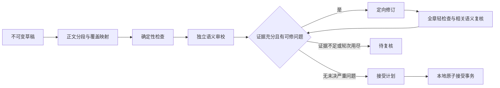

# P5：覆盖检查、定向修订与译文接受设计

日期：2026-10-16  
状态：P5工程实现与三章有界开发验证已完成，见 [P5实施与验证](translation-p5-results.md)。下文保留原规划依据；当前真实章均未接受，模型漏检、错误裁决和修订新增漏译已实测，不能据此启用自动接受。

最新实现补充见 [prompt、证据协议与能力诊断](translation-p5-audit-v2-results.md)。新增显式 `audit-v3` profile：程序绑定完整段落、区分内部含义／实际历史用法／风格偏好，历史命名连续性不等于全书规则批准；保留默认legacy请求。补丁逐目标段约束、残片规则检查、受限END及映射枚举恢复已实测。White及全部rank得到修复，局部语义审校仍不稳定；下一轮应分别验证短段语义核对、历史命名取证和模型对照，未将这些后续任务标为完成。

补充实现与验收见 [丰富上下文验证](translation-p5-context-results.md)：新增冻结的审校资料对象，审校/裁决/修订共享完整近章双语及分层前情，依赖和请求前缀均可校验。White历史译名漏检得到缓解；重复位置漏修和坏引文持续存在，质量门槛尚未达到。可选段落定位协议仅完成离线验证，默认严格引文协议保持不变。

## 1. 目标与边界

在现有 `run_translation()` 产生的 `draft_for_review` 之后增加可追溯的检查、有限修订和接受流程。最终回答三个独立问题：本章是否完整处理、哪些具体含义可能译错、这个版本是否允许作为后续的已译上下文。

P4.2 的粗摘要属于导航资料，引用缺失可标注使用；P5 的审校意见若要影响修订或接受，必须绑定目标原文及当前译文中的准确位置。可读摘要、成功解析、模型的“未发现问题”都不能单独构成语义准确的证明。

本阶段保留人物状态和知情推理的扩展入口；完整时序图归 P6。全自动连续调度与跨章重算归 P7。P5 先实现单章闭环和可靠的接受记录，不改变历史参考译文，不训练模型，不默认建立全书二级索引。

## 2. 当前基础与缺口

已有能力：

- `translation/narrative/translation.py`：冻结上下文重建、依赖与可见性核验、调用预留、草稿和断点恢复。
- `translation/workflow/__init__.py:initial_checks`：非空、长度、日文残留和输出格式提示。`semantic_coverage` 仍是未评估。
- `translation/narrative/summary_protocol.py`、`summary_admission.py`、`summary_repair.py`：摘要协议、逐项隔离及有界格式修复。
- `translation/narrative/scope_coverage.py`：本次试验补充的严格范围外缺章提示审查；保留原警告，对未知或真实缺口继续阻断。这不是一般语义审校器。
- `translation/context/multilevel.py`：全部一级摘要、附近二级摘要、最近完整双语、元信息工作集；当前没有模型自动取资料能力。
- `NarrativeStore`：不可变对象、请求账本；现有 `finish()` 是请求结束记录，不是译文接受事务。
- `KnowledgeBase.commit()`：知识版本和分支并发检查；其独立数据库不能与叙事数据库假装组成一个 SQLite 原子事务。

需要补齐：正文之外的覆盖映射、可落地审校意见、修订版本及回归验证、权威接受指针、可恢复的状态迁移。既有中文参考只能用于生成结束后的评估，不参与待译章的审校和修订。

## 3. 处理链路与阶段状态



流程状态为 `draft → checked → review_required / revision_proposed → revised → checked → accepted`。需要时独立记 `rejected`、`superseded`、`invalidated`。请求的 `running/completed/failed/unknown_remote_result` 与译文状态分开，远端调用完成不自动接受。

每个对象包含原文 revision、译文 hash、policy fingerprint、上下文 fingerprint、协议及检查器版本。检查绑定一个具体版本；修改正文后旧检查保留，但不能用于接受新版本。

初始策略采用显式接受。通过检查后可以产生 `eligible_for_acceptance`，由本地接受动作提交。未来批量自动接受须另设已验证的策略；模型自评无错不默认启用自动接受。

## 4. 正文与覆盖记录

保留纯中文正文，机器标记不混入成品。原文段落使用语料原始 `paragraph_id`；译文落盘后按固定分段规则产生稳定的目标段 ID，正文 hash 参与 ID 生成。

先确定正文范围：纯空白及仅承担版面的分隔项可确定性标为 `layout_exempt`，保留原 ID 和原因，不要求模型生成对应译句。省略号、语气音、短对白、场景切换的有意义符号不能因短小而自动豁免；作者前后记遵循已有正文分类，不临时按译文长短猜测。

第一版保持原有翻译 prompt，新增独立映射步骤，不要求译者在长正文中输出括号嵌套 JSON。模型只能选择已有段 ID，输出 `@@MAP` 平面记录；不让模型重写译文来完成映射。

映射对象至少包含：

```json
{
  "version": "translation-coverage-v1",
  "source_revision": "...",
  "translation_id": "...",
  "groups": [
    {"source_paragraph_ids": ["s1", "s2"], "target_paragraph_ids": ["t1"], "status": "mapped"}
  ],
  "unmapped_source": [],
  "unmapped_target": [],
  "uncertain": []
}
```

允许多对一和一对多，不能强制日中文段数相同。组内和组间检查顺序、范围、重复、空组及跨场景异常；原文被覆盖一次也可能只是误匹配，单独报告 `mapping_complete` 和 `semantic_coverage_reviewed`。未映射的有效正文阻止接受，合法省略须逐处有依据并显式审定，不能用“自然表达”整体豁免。

超长章节按完整场景或连续段区间分审，重叠部分只提供上下文，明确归属区间。若无法形成可靠映射，进入待复核；不能造段号填齐覆盖率。

## 5. 检查类型与判断权重

| 类型 | 初版动作 | 接受影响 |
| --- | --- | --- |
| 空正文、非正常结束、依赖变更、ID越界、确认漏段或重复 | 确定性检查 | 硬阻断 |
| 长度异常、数字/单位不同、括号不配对、日文残留 | 规则给出位置与候选 | 需复核，允许合理差异 |
| 已审定且适用的译名规则被违反 | 范围匹配加可回查证据 | 确认后阻断或修订 |
| 未审元信息的变体、摘要中的关系和时间 | 候选提示 | 不能单独判错或强制替换 |
| 漏译、增义、否定反转、主客体、条件范围、时态、称谓、明显说话者错误 | 独立模型审校加原文定位 | 高严重度先核证，未解决不得接受 |
| 自然度、语体、标点、同义措辞 | 单独风格意见 | 不为贴近参考而改动正确译文 |

数字检查先规范化全半角、汉字数字、约数和单位，保留否定、比较方向、主体和量词。不能仅用数字集合相等判断正确。日文中的人名残留也可能是合理未定名，不能全部视为失败。

审校器先独立阅读目标原文与草稿，再参考必要的近章正文、适用译名及摘要；模板明确以原文为最高依据。被摘要引入的设定不得倒灌为本章事实。审校器不接触本章已有中文，不用参考相似度充当忠实度分数。

对于相互冲突的历史译名，先记录是否属于同一实体、章区间和说话场景，再提出本章适用约定。第1200章注入工作集同时含“师傅／师匠”“乌鲁希／乌鲁西”，最近完整译文中也有变体；引文存在不等于全书统一规范已经确定。未审候选不能作为自动替换规则。P5.0先冻结一份小型适用约定夹具，P5.2按需回查原有双语证据；完整实体消歧留在后续，不通过投票把早期译法提升为全书硬约束。

## 6. 审校协议与依据准入

沿用平面记录思想，但新建独立的 `review-flat-v1` 协议，避免把摘要的宽松语义准入直接用于接受判断。

```text
@@FINDING f1
category: omission|addition|negation|role|number|term|tense|speaker|style|other
severity: critical|major|minor|suggestion
source_ref: 已提供的原文段ID | 逐字引文
target_ref: 当前译文段ID | 逐字引文
claim: 具体问题及含义差异
suggestion: 最小修订建议；无法确定时说明
confidence: high|medium|low
needs_lookup: 可选的node_id或线索
@@UNRESOLVED
text: 未能确认的问题
@@END
```

缺译时 `target_ref` 可用明确的缺失位置及相邻段，不伪造不存在的译句；需外部知识时可另外引用经过权限检查的资料片段。所有引文在对应版本中逐字核验。无法定位、证据不支持结论、把非适用术语当硬规则等意见隔离为候选，不自动执行。

意见状态为 `candidate / grounded / confirmed / dismissed / unresolved / resolved`。`grounded` 仅代表引用存在；不等于逻辑成立。初版高严重度意见用独立复核请求或人工裁决确认，记录裁决依据与角色。相同上游模型的独立请求仍有相关性，应保留这一限制。

格式解析支持围栏、换行、已知字段别名及重复记录；未知字段、相互冲突意见保留原始输出并隔离。仅在格式损坏而内容可恢复时最多一次格式修复，不把“证据不够”交给修复模型编造。拒绝、截断、网络未知结果不能伪装为格式问题。审校输出空白或不完整不表示零缺陷。

## 7. 按需取证，先做有界工具接口

大多数问题可通过本章原文解决。确需前文时先显式提出查询，按以下顺序获取：已有二级摘要 → 经许可的前文原文/对应译文 → 确有必要且预算允许时新建二级摘要。`missing_reference` 不自动触发全量回查。

第一版采用编排器的一次 `needs_lookup` 往返，不实现无限自主代理。默认每章至多 2 次取证动作，最多新建 1 个二级摘要；读取也记录输入量，计入后续模型上下文预算。只允许章节截止位置之前、非预留且有权限的材料。隐藏目标中文和未来中文在所有工具层均拒绝。

查询结果返回资料范围、版本、缺失状态、质量和出处；无结果明确返回 `not_found / not_built / denied / budget_exceeded`。没有找到不能被审校器解释为事实不存在。新增二级元信息产生新的快照，既有翻译上下文和检查仍绑定旧快照；如采用新快照修订，产生新的上下文指纹。

## 8. 定向修订和回归

仅修复已核证的意见，每次输入原文、当前完整译文、已确认问题及必要证据，输出带目标段 ID 的替换补丁。补丁包含 `expected_text_hash`，应用前验证旧文本，禁止覆盖未匹配版本。先用小范围替换，确因多段合并需要可替换连续区间；第一版限制为原有目标段的连续范围，暂不支持任意结构重排。

每轮保存原始补丁、解析结果、变更范围、新正文及新 hash。重新跑全章轻量检查和覆盖映射，语义复核覆盖改动处与相邻上下文，确认原问题是否解决，并检查新引入的否定、主体、数字和指代错误。影响全章术语时扩大复核范围；不能只问“是否已经修好”。

最多两轮语义修订；无改善、往返改写、证据冲突或预算耗尽则进入待复核。仅有风格建议时不默认重写整章。修订产生的新知识仍是候选，不能因为译文更流畅就自动变为已确认实体知识。

## 9. 原子接受及知识隔离

权威接受记录、当前译文指针、接受所关联的本章状态和候选知识清单放在同一 `NarrativeStore` SQLite 连接中。新增不可变 `translation-version`、`review-report`、`revision`、`acceptance` 对象，以及事务性 `accepted_heads` 和幂等键表。远端调用先完成、对象先落盘，接受事务内不进行 HTTP。

`plan_acceptance()` 生成具体清单：译文版本、检查版本、未决问题、依赖、知识候选、预期旧 head、接受策略版本、操作者及理由。`accept_translation()` 在一个本地事务中重新核验：

1. 依赖和原文/译文/报告 hash 未变；所有检查针对待接受版本。
2. 没有硬失败、未解决的已确认严重错误和必须裁决的严重候选。
3. `expected_head` 相符；幂等键未用于另一份内容。
4. 原子插入接受记录、更新权威指针、提交关联状态及待发布候选。

`KnowledgeBase` 保持独立时，只能作为接受后的可重建投影。采用带 `acceptance_id` 的 outbox，幂等发布，消费者核验权威接受 head；投影未同步不影响接受事实，查询只能使用已发布并符合接受版本的内容。不得把两个数据库先后提交称为原子提交。初版不自动提升译名/实体候选，是否升级为知识需独立审定；因此无需为了接受一章而写入全局知识库。

撤销采用新事件和指针变更，不删除历史。后续依赖被撤销译文的上下文标为失效并拒绝继续接受；完整任务重算在 P7，P5 提供依赖清单和失效状态。旧草稿不得因文件存在被当成有效已译章。

接受译文还需一个读取适配层。目前 `NarrativeView.read_chapters()` 从冻结语料及章级配对审查读取已有中文，不会自动读生成目录。P5 增加接受感知的只读适配器，给自译正文分配独立文档 ID 和版本，返回来源 `generated_accepted`、接受 ID、覆盖映射及日文依赖；近章编译通过该适配器显式选用已接受正文。不能把它伪装成原有中文参考，也不能仅检查磁盘上存在 `translation.json`。

适配器必须沿用截止位置、预留集和派生依赖检查；被隐藏来源派生的译文不会因“已接受”而绕过评测隔离。接受被撤销或 head 变更后，旧上下文依赖校验失败。P5 先验证一章接受后的合法读取及草稿不可读，P7 再做连续调度。接受不触发重读整个未闭合100章一级节点；该节点的更新和已接受增量如何桥接属于 P7 的成本与覆盖策略。

## 10. 拟新增模块与 API

以下均为拟议接口；没有实施前不作为现有命令或工具暴露。

| 模块 | API | 返回/作用 |
| --- | --- | --- |
| `translation/review/segments.py` | `segment_translation(text, source_revision)` | 稳定目标段与正文版本 |
| `translation/review/coverage.py` | `map_coverage(view, version, provider, limits)` | 不可变覆盖记录与未映射项 |
| `translation/review/checks.py` | `run_checks(view, version, coverage, conventions)` | 硬失败、信号和定位 |
| `translation/review/service.py` | `review_translation(view, version, context, provider, limits)` | 审校报告、候选及已定位意见 |
| 同上 | `adjudicate_findings(view, report, decisions)` | 有依据的裁决版本 |
| `translation/review/lookup.py` | `resolve_review_queries(view, queries, limits)` | 可见资料及拒绝原因 |
| `translation/review/revision.py` | `propose_revision(...); apply_revision(version, patch)` | 补丁及新译文，不自动接受 |
| `translation/review/acceptance.py` | `plan_acceptance(...); accept_translation(..., expected_head, idempotency_key)` | 可检查的接受计划及原子提交 |
| 同上 | `read_accepted(chapter_id); invalidate_acceptance(...)` | 仅有效版本、撤销依赖记录 |
| `translation/review/accepted_view.py` | `read_accepted_pair(view, chapter_id)` | 有来源标签和接受版本的双语范围；供近章编译适配 |

所有会调用模型的接口显式接收 provider、模型公开身份、策略和同一本章预算账本；读取接口不暗中付费创建摘要。CLI 顺序拟为 `review prepare/check/run/revise/accept/status`，默认 `run` 只到可接受候选，`accept` 是独立显式本地动作。

## 11. 执行顺序与验收

| 子阶段 | 功能与产物 | 通过条件 |
| --- | --- | --- |
| P5.0 | 以 main:1200 草稿冻结真实缺陷集；段版本、报告与状态 schema；接受策略 | 每个问题有源句、译句、分类和确定程度；没有参考译文进入生成/审校 |
| P5.1 | 稳定分段、覆盖映射、确定性检查、可读报告 | 合并/拆分合法；漏段/重复/错 ID/截断阻断；长度和合理数词变化不误判硬失败 |
| P5.2 | 独立语义审校、平面协议和依据校验；可选一次取证 | 意见可定位；坏引用隔离；抽样核查误报/漏报；隐藏及预留资料无法被取回 |
| P5.3 | 最多两轮补丁修订与回归 | 修复已确认缺陷，比较新增错误；版本冲突及预算耗尽能恢复到待复核 |
| P5.4 | 接受计划、原子指针和候选知识/outbox、撤销失效 | 崩溃前后状态一致；幂等不重复；并发旧 head 拒绝；草稿不进入连续已译上下文 |
| P5.5 | 少量开发章有界对照和文档 | 同一初稿比较无审校/只审校/审校加修订；报告成本、缺陷变化及限制，不据单章宣称稳定收益 |

验证先离线夹具，再本章，再少量不同场景开发章。合成缺陷至少包含漏段、重复、否定翻转、数值与单位、名字替换、主客体互换；对照自然意译、段落合并、合理敬称差异等无缺陷样本。测量各类召回、误报和修订新增错误，不只测 JSON 能解析或报告非空。

初始设计曾估算8次调用，但遗漏每次修订后的重新映射。实施的第1200章冻结开发方案上限为13次：映射3、审校4（含独立／辅助两臂和两轮回归）、裁决3、修订2，另按类型允许最多一次格式转录或显式摘要构建，所有类型共同受13次总门禁约束。实用12次，包括解析规则变动后一次额外裁决。输入上限700000、输出262144、上下文1048576；两个旧草稿补测独立上限9次，实际6次。取证后不能确认仍待复核，不通过扩预算隐去失败；详细预留和实际用量见实施报告及冻结计划。

输出预留必须覆盖提供方计入的思考 tokens，不能仅按可见报告字数估算。本轮 1200 章试验的首个 100 章节点使用 16,000 输出上限，其中 15,514 用于思考，摘要刚开始就以 `length` 截断；这类失败需要重新规划输出预算，不能调用格式修复来补写缺失内容。原失败及实际用量继续计入累计账本。

先完成 P5.0–P5.1 的无付费与低付费基础，再允许 P5.2–P5.3 的真实调用；每个阶段产出冻结计划、原始响应、解析报告、版本链、费用/用量与只读复现入口。没有用户另行授权，不因设计文档存在而开始批量 P5 开发或全书审校。

## 12. 进入条件和本次证据

本次 main:1200 已满足进入设计的门槛，详见 [P4.2 第1200章验收报告](translation-p4.2-1200-acceptance.md)：1154章可见双语前文形成12个一级概括，仅懒建附近2个二级概括，结合1197–1199完整双语生成目标章。目标中文在生成与原文优先审阅之后才导出。实际翻译输入47461 tokens、输出1392 tokens；完整工程审计通过，190项回归通过。首次全索引构建包含截断、未知超时和一次弃用候选重采样；累计已知8772552 tokens，未知超时用量另计，不将这些失败隐去。

本次草稿正文大致完整，原文优先审阅检查21个预先列出的要点，但仍有两项应修订的局部语义问题及其他质量风险。P5.0可直接使用 [冻结的原文审阅](../artifacts/translation/tenken-cache-clean/verification/p4.2-accept-1200/live/source-based-review.json)和 [可读问题清单](../artifacts/translation/tenken-cache-clean/verification/p4.2-accept-1200/live/development-review.md)，以具体草稿hash绑定下列开发案例：

| 案例 | 触发内容 | P5预期行为 |
| --- | --- | --- |
| 体验主体反转 | 女神“你不会再吃惊了”译成“已经不再让我惊讶了” | 独立审校定位源句和译句，确认后最小修订，并核验相邻对白 |
| 省略对象误补 | 吸收残留魔石写成“吸收还残留魔石的个体” | 依原文和尸体收纳上下文确认对象，避免仅作流畅化润色 |
| 与参考共享错误 | `寝息`在草稿和参考都写成“打鼾” | 审校不依赖目标参考，仍识别无依据增义；相似度不抵消错误 |
| 历史译名冲突 | 同章混用“师傅／师匠”，工作集同时提供两者 | 分离内部一致性与跨章适用约定；未审候选不强制替换 |
| 条件措辞歧义 | “接受东征公的叛乱后还会保护他们” | 核对保护对象与两个疑问分支，保留国家立场未知 |
| 规则漏检 | 初始检查无警告，语义覆盖仍未评估 | 报告明确未评估状态，不以“无警告”晋升为接受 |

这些是已经观察到的开发案例，不能再用作盲测；P5.5需另选不同场景开发章，并保留后续未接触的评测集。本次没有做本章few-shot对照，没有证明层次索引带来稳定质量提升。14份摘要仍为语义未审导航候选，249处缺引用和34个隔离元信息条目均保留；接受一章不会顺带确认全部摘要。

以上为P4.2进入设计时的历史证据。后续已按P5.0–P5.5实施闭环及有界开发案例，独立／辅助检出与助手裁决分开记录；旧P4.2产物不覆盖，P5另建版本与账本。当前接受计划保留规则信号和历史未决，真实章仍不进入有效已译上下文。

P5工程完成依据是可运行的闭环、离线测试与真实开发产物，详见 [实施报告](translation-p5-results.md)。充分独立的质量评测、稳定质量收益及自动接受策略仍待后续验证。
